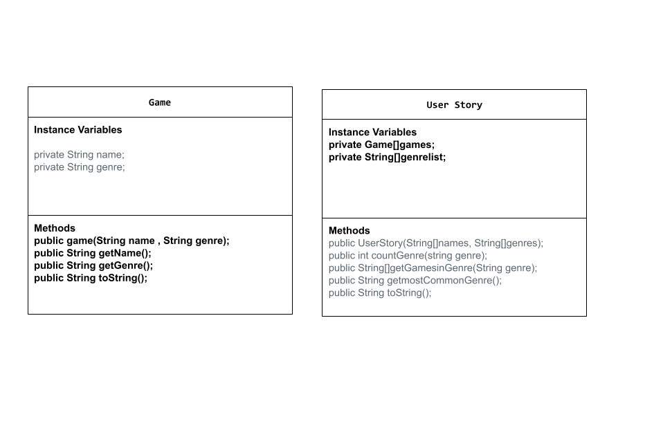

# Data-for-Social-Good
different needs based on the information they are looking for from data. Your goal is to create a data analysis program for your user that stores and analyzes data to provide the information they need.

## Requirements

Use your knowledge of object-oriented programming, one-dimensional (1D) arrays, and algorithms to create your data analysis program:
- **Write a class** – Write a class to represent your user or business and store and analyze their data with no-argument and parameterized constructors.
- **Create at least two 1D arrays** – Create at least two 1D arrays to store the data that your user needs information about.
- **Write a method** – Write a method that finds or manipulates the elements in a 1D array to provide the information your user needs.
- **Implement a toString() method** – Write a toString() method that returns general information about the data (for example, number of values in the dataset).
- **Document your code** – Use comments to explain the purpose of the methods and code segments and note any preconditions and postconditions.

## User Story 

Include your User Story you analyzed for your project here. Your User Story should have the following format: 

>As a gaming enthusiast,  
> I want to find video games by their genre,  
> so that I can quickly discover games that match the kind of gameplay I enjoy.
## Dataset 

Example: 

Title (String): the name of the video game, such as “Elden Ring” or “Super Mario 64.” It is stored one per line in titles.txt.

Genre (String): the game’s main category, one of five values: Role-Playing, Action-Adventure, First-Person Shooter, Platformer, or Sports. It is stored one per line in genres.txt, on the same line number as its title.

Dataset: https://claude.ai/chat/4ea5ee6e-169a-474b-9f6d-3fb2a0f6e437

## UML Diagram 

 

## Description 

This project helps a gaming enthusiast find video games by genre. Our dataset is two parallel text files we created: `names.txt` (100 game names) and `genres.txt` (each game's genre). In `DataRunner`, each file is read into a **1D array** of **Strings** and passed as **parameters** to the `UserStory` **constructor**, which uses a **for loop** to **traverse** both arrays and create a `Game` **object** at each **index**. The `Game` class has private **instance variables** and **accessor methods**. `UserStory` has **methods** that analyze the data: `countGenre()` counts games in a genre using `.equals()`, `getGamesInGenre()` **returns** a new **array** of games in a chosen genre, `getMostCommonGenre()` finds the genre with the most games, and `toString()` **returns** a summary of the data. Using the **Scanner** class, the user types a genre and the program prints every matching game, or "No games found" if there are none.